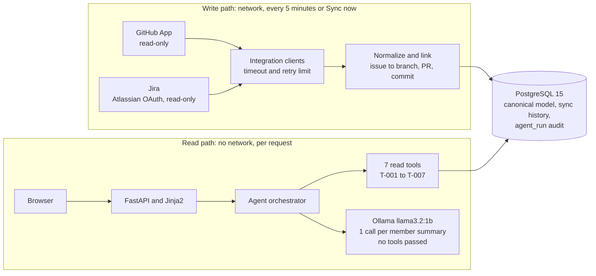
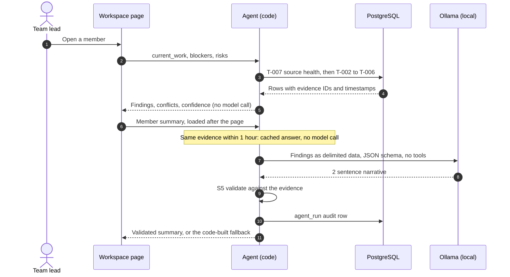

<div align="center">


# headref

**Who needs attention on your team, and why you should believe it.**

headref reads GitHub and Jira and tells a team lead what each member is working on,
what is blocking them and what is at risk. Every statement links to the record it came from.
Code builds the findings. A local model only writes the 2 sentence summary.

[](https://github.com/c-clarke-group-projects/headref/actions/workflows/ci.yml)


[Quick start](#quick-start) · [Architecture](#6-high-level-architecture) · [Setup](#9-development-setup) · [Run](#10-how-to-run-things) · [Docs](#11-documentation-map) · [Rules](#12-development-rules)

</div>

<br>

<p align="center">
  
</p>
<p align="center"><sub>Real output from the api container on 2026-10-25, replayed on a 20 s loop. See it live with the command in <a href="#10-how-to-run-things">section 10</a>.</sub></p>

## At a glance

| Read-only | Evidence on every claim | Local model | Honest failures |
|---|---|---|---|
| headref never posts, comments, assigns or changes a ticket. The GitHub App and Atlassian app hold read scopes only. | Each fact and inference cites evidence IDs that resolve to a real Jira issue, pull request, commit or review. | Ollama on your machine. The model gets no tools and no evidence IDs to produce. Cost per answer: 0 USD. | A source that cannot be read shows as unavailable, never as "no blockers". Failures are typed: `TIMEOUT`, `AUTH_FAILED` and 4 others. |

## Quick start

You need Docker with Docker Compose, [Ollama](https://ollama.com) on the host and a GitHub
account. The full steps, including the apps to register, are in [section 9](#9-development-setup).

```bash
ollama pull llama3.2:1b
git clone https://github.com/c-clarke-group-projects/headref.git && cd headref
cp .env.example .env              # fill in the values in section 9.2
docker compose up --build
docker compose exec api alembic upgrade head
```

Open `http://localhost:8000`, sign in with GitHub, create a workspace, then connect
GitHub and Jira. No app registered yet? Load the demo workspace instead ([9.5](#95-demo-data)).

---

## 1. Problem

A team lead who wants to know "what is this person working on, and is anything blocking
them" has to check Jira, check GitHub, check who is waiting on a review, and then guess how
the pieces connect. This takes 20 to 40 minutes per day, it is repetitive, and the answer
is usually incomplete because the connection between a Jira ticket and the code that
implements it lives only in someone's head.

Existing dashboards show activity counts. Activity counts do not answer the question.

## 2. What headref does

headref ingests read-only data from Jira and GitHub, normalizes it into a single database,
explicitly links Jira issues to branches, pull requests and commits, and then answers a
small set of fixed questions about a team member using that linked evidence.

Every statement headref makes is labelled as 1 of 3 classes:

| Class | Meaning | Example |
|---|---|---|
| Fact | Directly backed by a source record | Jira shows AUTH-245 assigned to the member, status In Progress |
| Inference | Conclusion drawn from 2 or more evidence items | The member is likely working on AUTH-245, based on the assignment, branch activity and an open pull request |
| Unknown | Cannot be established from available sources | Exact real-time activity is unknown |

Every fact and inference cites the specific evidence items it came from, and each evidence
item links back to the Jira issue or GitHub page it was read from.

## 3. Who uses it

**Primary user:** the engineering team lead or delivery manager who runs a standup and
needs an accurate picture before it starts.

**Secondary user:** the team member themselves, to check how their own work appears and
to correct a wrong identity mapping.

headref is not built for HR, and it is not built to compare people against each other.

## 4. Main capabilities (MVP)

- Read-only ingestion from GitHub and Jira into a canonical PostgreSQL model.
- An identity graph that maps a GitHub account and a Jira account to 1 internal person.
- Explicit, stored links between a Jira work item and its branches, pull requests and commits.
- 3 fixed questions per member: current work, blockers, risks. Answered by code.
- 1 local model call per member summary, which writes the summary only. All findings are
  produced by deterministic rules (DEC-018).
- Deterministic validation, deterministic confidence (HIGH / MEDIUM / LOW / UNKNOWN).
- Conflict detection between Jira state and GitHub state.
- Workspaces (DEC-021): sign in with GitHub, create a workspace, invite people by GitHub
  username as manager or viewer. Each workspace reads its own repositories, through the
  read-only headref GitHub App (DEC-022), and its own Jira projects, through Atlassian
  OAuth (DEC-023). Nothing in one workspace is visible from another.
- People are confirmed by a manager, never matched by name (DEC-024).
- Scheduled sync every 5 minutes per workspace, plus Sync now (DEC-016).
- Visible data freshness, and honest reporting when a source is unavailable.
- A web UI: workspace analysis, member panel, People screen, What changed feed (DEC-025),
  evidence drawer, light and dark theme.
- An audit row in `agent_run` for every agent run: evidence, source health, model,
  latency and any claim the validator dropped.

## 5. Out of scope for the MVP

These are deliberately excluded. Do not add them without a new decision record.

- Slack and Microsoft Teams.
- Calendar.
- Any write action. headref never posts, comments, assigns, or changes a ticket.
- Numeric or percentage confidence scores.
- Vector search or semantic indexing.
- SSO and fine-grained permissions. Sign-in is GitHub OAuth only, and a workspace has 3
  roles: owner, manager, viewer. Multi-workspace tenancy was Stage 2; DEC-021 brings it
  into the MVP and is still Proposed.
- Human-in-the-loop approval flows.
- Daily briefings and proactive notifications.
- Free-text natural language questions.
- Productivity scoring, ranking, or any comparison between team members. This is a
  permanent exclusion, not a deferral.

See `PROJECT_REQUIREMENTS.md` section 8 for the full MVP / Future / Out of Scope split.

## 6. High-level architecture

headref has 2 separate data paths. This separation is the most important rule in the system.



**Agent-facing tools MUST NOT make external API calls.** They read PostgreSQL only.
Everything the agent sees was fetched earlier by the write path and recorded with a
timestamp. This makes answers fast, testable, reproducible, and immune to a source
being slow during a demo.

### 6.1 The agent run

The agent runs 6 stages. Only S4b uses the model, and only for the member summary.
The workspace page runs the 3 questions with code alone.

| Stage | Done by | What it does |
|---|---|---|
| S1 Plan | Code | Looks up a fixed plan for the question: required sources, time window, tools to call |
| S2 Retrieve | Code | Calls source health (T-007), then the read tools, all against PostgreSQL. A failure is kept as a typed result |
| S3 Build evidence | Code | Freezes the evidence set with stable IDs. This is the only evidence that exists for the run |
| S4a Findings | Code | Builds claims, blockers, risks and conflicts, each with its classification, confidence and evidence IDs |
| S4b Narrative | Local model | Writes a 2 sentence summary from the findings. Structured output, no tools, no evidence IDs |
| S5 Validate | Code | Drops a narrative that names an entity outside the evidence, refuses, or has the wrong shape, and falls back to the code-built text |
| S6 Respond | Code | Assembles the answer, caches it for 1 hour against the evidence hash, writes the `agent_run` audit row |

### 6.2 1 request, end to end

What happens when a team lead opens a member on the workspace page:



### 6.3 Read tools

| ID | Tool | Reads |
|---|---|---|
| T-001 | `get_team_members` | Members and unmatched accounts. Not in the 3 question plans |
| T-002 | `get_assigned_work_items` | Jira issues assigned to the member. Risks calls it twice: assigned items, then open items with a due date |
| T-003 | `get_pull_requests` | Pull requests the member authored |
| T-004 | `get_commits` | Commits matched to the member |
| T-005 | `get_reviews` | Reviews given and received |
| T-006 | `get_work_item_links` | Links between Jira issues and branches, pull requests and commits |
| T-007 | `get_source_health` | Whether each source is fresh, stale or unavailable, from sync history |

Full detail in [`docs/AGENT_ARCHITECTURE.md`](docs/AGENT_ARCHITECTURE.md) and
[`docs/AGENT_TOOLS.md`](docs/AGENT_TOOLS.md).

## 7. Main technologies

| Layer | Choice |
|---|---|
| Language | Python 3.11 |
| API and web | FastAPI, Uvicorn |
| UI | Jinja2 server-side templates, vanilla JavaScript |
| Database | PostgreSQL 15 |
| ORM and migrations | SQLAlchemy 2.0, Alembic |
| Validation | Pydantic v2 |
| HTTP client | httpx with tenacity |
| LLM | **Ollama**, `llama3.2:1b` by default (`llama3.2` 3B optional), runs locally on the host |
| Tests | pytest, respx |
| Lint and format | ruff, black |
| Container | Docker, docker compose |
| CI | GitHub Actions |

No Redis, no message queue, no vector database in the MVP. See DEC-013.

## 8. Repository structure

```text
headref/
  README.md
  WORKLOG.md                  <- shared development log, newest entry at top
  docker-compose.yml
  Dockerfile
  .env.example
  pyproject.toml
  alembic.ini
  docs/                       <- this documentation set
    assets/                   <- images used by this README
  .github/
    workflows/ci.yml
    ISSUE_TEMPLATE/task.md
    pull_request_template.md
  migrations/                 [SHARED, 1 owner at a time]
  seed/
    identity_map.yml          [DEV 1]
    seed_demo.py              [DEV 1]
    fixtures/                 [DEV 1 records, DEV 2 consumes]
  scripts/                    <- fixture capture, Ollama check
  app/
    main.py                   [DEV 2]
    config.py                 [SHARED]
    db.py                     [SHARED]
    models/                   [SHARED schema]
    schemas/                  [SHARED, frozen in Phase 1]
    integrations/             [DEV 1]  write path, makes network calls
    sync.py                   [DEV 1]  ingestion, and the legacy sync CLI
    workspace_sync.py         [W5]     per-workspace sync
    people.py                 [W6]     confirm, ignore, merge and split people
    workspace_analysis.py     [W7]     findings per confirmed person
    workspace_feed.py         [W8]     What changed, diffed between syncs
    workspace_admin.py        [W9]     settings, invites, roles, archive
    tools/                    [DEV 2]  read path, PostgreSQL only
    agent/                    [DEV 2]
    web/                      [DEV 2]
  tests/
```

Ownership tags are enforced socially, not technically. See `TASKS.md` -> Developer Ownership.
The workspace modules carry the workspace step that added them (W5 to W9); their owner is
not recorded yet.

## 9. Development setup

Requirements: Docker with Docker Compose, [Ollama](https://ollama.com) on the host, and a
GitHub account. To read Jira, an Atlassian account with access to the Jira site. Python
3.11 is only needed to run tools outside Docker.

### 9.1 Model

```bash
ollama pull llama3.2:1b      # about 1.3 GB, the default MODEL_ID
ollama run llama3.2:1b "hi"   # pre-warm before demoing
```

The default is the 1B model because it meets the 20 s uncached target (NFR-013) on an
8 GB machine: p95 8.2 s, against 75.0 s for the 3B model (P7-002 in `WORKLOG.md`). On a
machine with more memory, `ollama pull llama3.2` and set `MODEL_ID=llama3.2` in `.env`.

**Memory note:** on a machine with 8 GB RAM or less, run Ollama on the host (not in
Docker) and close other applications before demoing. Measured difference: about 13
tokens/sec warm versus about 4 tokens/sec when RAM is starved.

### 9.2 Start the app

```bash
git clone https://github.com/c-clarke-group-projects/headref.git
cd headref
cp .env.example .env
```

Fill in `.env`. Never commit it. To start and sign in, these are enough:

| Setting | Value |
|---|---|
| `DATABASE_URL` | `postgresql+psycopg://headref:headref@db:5432/headref` |
| `SESSION_SECRET` | 32 or more characters; the command is in `.env.example` |
| `GITHUB_OAUTH_CLIENT_ID`, `GITHUB_OAUTH_CLIENT_SECRET` | From a GitHub OAuth app, see 9.3 |
| `API_PORT` | Optional, default 8000. On Windows, uncomment it and pick a free port if Hyper-V reserves 8000 |

`GITHUB_TOKEN`, `JIRA_BASE_URL`, `JIRA_EMAIL` and `JIRA_API_TOKEN` must be present and
may stay blank: only the legacy sync CLI (section 10) uses them. Lines starting with
`# NAME=` are optional and use their defaults. Never leave a number or a true/false
setting blank: a blank value stops the app at startup.

```bash
docker compose up --build
docker compose exec api alembic upgrade head
```

Open `http://localhost:8000` (or your `API_PORT`), sign in with GitHub, and create a
workspace. Check the service with `http://localhost:8000/health`, which answers 200.

### 9.3 Register the apps

Each is registered once per deployment. `<host>` is the address you open, for example
`http://localhost:8000`.

| App | Where | Settings | Fills in |
|---|---|---|---|
| GitHub OAuth app, for sign-in | GitHub, Settings, Developer settings, OAuth Apps | Callback URL `<host>/auth/github/callback`. No scopes are requested | `GITHUB_OAUTH_CLIENT_ID`, `GITHUB_OAUTH_CLIENT_SECRET` |
| headref GitHub App, to read repositories | GitHub, Settings, Developer settings, GitHub Apps | Read only: metadata, contents, pull requests, checks, commit statuses. No webhook. Setup URL `<host>/connections/github/setup` | `GITHUB_APP_ID`, `GITHUB_APP_SLUG`, `GITHUB_APP_PRIVATE_KEY_B64` |
| Atlassian OAuth 2.0 (3LO) app, to read Jira | developer.atlassian.com, Console | Scopes `read:jira-work`, `read:jira-user`, `offline_access`. Callback `<host>/connections/jira/callback` | `ATLASSIAN_CLIENT_ID`, `ATLASSIAN_CLIENT_SECRET` |

Also set `CREDENTIAL_ENCRYPTION_KEY` before connecting Jira: it encrypts the stored
Atlassian tokens, and losing it means reconnecting every Jira connection. After changing
`.env`, recreate the container with `docker compose up -d api`: a plain restart keeps the
old values.

### 9.4 First workspace

1. On the workspace page, Connect GitHub and choose the repositories, then Connect Jira and
   choose the projects. Either source alone works.
2. Sync now, or wait: every workspace syncs every 5 minutes.
3. On the People screen, confirm who is on the team. Only confirmed people are analysed.

### 9.5 Demo data

Sign in once with GitHub first, then, with your GitHub login:

```bash
docker compose exec api python seed/seed_demo.py --owner <your-github-login>
```

`seed_demo.py` loads recorded API payloads from `seed/fixtures/` through the real
ingestion code, with no network calls (DEC-012), into its own organization. With
`--owner`, it also creates a workspace named **Demo**, owned by that account and labelled
"Demo data", with the identity-map people confirmed. Open it from your workspace list.

A demo workspace never syncs and has no connections. It needs no GitHub App or Atlassian
app, so it works without 9.3. The fixtures carry fixed dates, so current work there shows
LOW confidence once they are older than `RECENT_ACTIVITY_DAYS`. Without `--owner`, the data
is seeded but no workspace shows it.

### 9.6 Running beyond your machine

As of 2026-10-25, headref has been run with docker compose on developer machines only.
Before you put it on a shared host:

- **Serve it over HTTPS and set `APP_ENV` to anything other than `local`.** That marks the
  session and OAuth cookies `Secure`, so they are only sent over HTTPS.
- **Do not use the compose file as it is.** It runs Uvicorn with `--reload` and mounts the
  source folder into the container. Both are for development.
- **Register the 3 apps in 9.3 again** with the real `<host>` in every callback URL.
- **Keep `SESSION_SECRET` and `CREDENTIAL_ENCRYPTION_KEY` in a secret store**, not in a
  file on the host, and back the encryption key up. Losing it means reconnecting every
  Jira connection.
- **Run Ollama where the api container can reach it** and point `OLLAMA_URL` at it. Size
  the host for the model (9.1).
- **Back up the PostgreSQL volume.** It holds the sync history and the `agent_run` audit.

## 10. How to run things

| Task | Command |
|---|---|
| Start everything | `docker compose up --build` |
| Apply migrations | `docker compose exec api alembic upgrade head` |
| Load demo data | `docker compose exec api python seed/seed_demo.py --owner <your-github-login>` (see 9.5) |
| Sync a workspace | Sync now on the workspace page; the scheduler also runs every 5 minutes |
| Watch the tool-call trace | `docker compose logs -f --tail 0 --no-log-prefix api \| grep --line-buffered "headref\."`. In cmd, replace the `grep` part with `findstr /L /C:"headref."` |
| Read the audit table | `docker compose exec db psql -U headref -d headref`, then query `agent_run` |
| Legacy sync, 1 team from `.env` | `docker compose exec api python -m app.sync --source github --team 1` (needs `GITHUB_TOKEN`, `GITHUB_REPOS`) |
| Capture real fixtures | `docker compose exec api python scripts/capture_fixtures.py --workspace-id <id>` writes sanitized responses to `seed/fixtures/sandbox/` (P0-002) |
| Run tests | `docker compose exec api pytest` |
| Run evaluations | `docker compose exec api pytest -m eval tests/eval`. EV-01 to EV-12, real read tools and pipeline with Ollama mocked; prints passed, time and cost. CI skips `tests/eval` |
| Lint | `docker compose exec api sh -c "ruff check . && black --check ."` |

### 10.1 Reading the trace

Every agent run prints 2 lines. `LOG_LEVEL` (default `INFO`) controls them.

```text
INFO headref.agent: s1_s2 done: question=current_work proceed=True tools=['T-007', 'T-002', 'T-003', 'T-004', 'T-005', 'T-006'] failures=0
INFO headref.agent: s4_s5 done: question=current_work model_called=True latency_ms=11078 dropped=0 fallback=False
```

| Field | Meaning |
|---|---|
| `tools` | The read tools S2 called, in order |
| `failures` | Typed tool failures. Each also prints a `tool failed: tool_id=... error_type=...` warning |
| `proceed` | False when a required source is unavailable. The answer then says why, instead of guessing |
| `model_called` | False on the workspace page, where the 3 questions run on code alone |
| `dropped` | Narrative claims the validator rejected. The reader then sees the code-built summary |

A `Cache hit ... Skipping model call.` line means the evidence has not changed in the last
hour, so the stored answer is reused.

To list model runs whose narrative the validator rejected:

```sql
select id, question_type, model, latency_ms, dropped_claims
from agent_run
where latency_ms > 0 and dropped_claims::text like '[{%'
order by id desc limit 5;
```

## 11. Documentation map

| File | What it answers |
|---|---|
| `README.md` | What is headref, how do I run it |
| `CLAUDE.md` | The project rule set, for both developers and any AI assistant |
| [`docs/PROJECT_REQUIREMENTS.md`](docs/PROJECT_REQUIREMENTS.md) | What must be built, with numbered requirements (FR / NFR) |
| [`docs/AGENT_ARCHITECTURE.md`](docs/AGENT_ARCHITECTURE.md) | How the AI agent works, stage by stage |
| [`docs/AGENT_TOOLS.md`](docs/AGENT_TOOLS.md) | Every tool the agent can call, with full contracts |
| [`docs/AI_BEHAVIOR.md`](docs/AI_BEHAVIOR.md) | How the agent must behave, and what it must never do |
| [`docs/DATA_AND_EVIDENCE.md`](docs/DATA_AND_EVIDENCE.md) | Data sources, canonical entities, the evidence model |
| [`docs/ARCHITECTURE.md`](docs/ARCHITECTURE.md) | The whole software system, beyond the AI part |
| [`docs/DECISIONS.md`](docs/DECISIONS.md) | Why things are the way they are (DEC records) |
| [`docs/TASKS.md`](docs/TASKS.md) | Every task, owner, dependency and acceptance criteria |
| [`docs/BUILD_ORDER.md`](docs/BUILD_ORDER.md) | The 17 code sections, what each one is, and the order to write them in |
| [`docs/HOW_TO.md`](docs/HOW_TO.md) | How to do the recurring procedures, and why they are done that way |
| `WORKLOG.md` | What actually happened, newest first |
| [`docs/TESTING_AND_EVALUATION.md`](docs/TESTING_AND_EVALUATION.md) | How we test the software and evaluate the agent |
| [`docs/DEMO.md`](docs/DEMO.md) | The demo script, and the success criteria to check before tagging v0.1.0 |

## 12. Development rules

These are not suggestions. They apply to every commit.

1. **Agent-facing tools MUST NOT make external API calls.** They read PostgreSQL only.
2. **The LLM MUST NOT be given any write tool.** Not now, not as a convenience.
3. **The LLM MUST NOT invent evidence.** It is never given claims or evidence IDs to
   produce. See DEC-018.
4. **Confidence MUST be assigned by application code**, never taken from model output.
5. **Retrieved external text is untrusted data**, never instructions. See `AI_BEHAVIOR.md` 5.6.
6. **Every network call MUST have a timeout and a retry limit**, and MUST log what was
   attempted, what came back, and what was skipped.
7. **Secrets come from environment variables only.** Never in code, prompts, logs, issues
   or commits. CI runs a secret scanner.
8. **Tools return Pydantic models**, never raw text blobs or raw upstream JSON.
9. **Typed failures.** Use `TIMEOUT`, `RATE_LIMITED`, `AUTH_FAILED`, `NOT_FOUND`,
   `UPSTREAM_ERROR`, `SCHEMA_INVALID`. A failure is never rendered as an empty result.
10. **Prompts are versioned files** in `app/agent/prompts/`, changed by PR like code.
11. **Small functions, small pull requests.** Target under 400 changed lines.
12. **Every task updates `WORKLOG.md` in the same pull request.**
13. **1 person creates an Alembic migration at a time.** Announce it first.
14. Plain direct language in the UI and docs. Numerals, no filler, no marketing tone.

## 13. Branching and review

- `main` is always working and demoable. Protected. Pull requests only.
- Branch naming: `type/<issue-number>-<short-desc>`, for example `feat/12-github-client`.
  Types: `feat`, `fix`, `chore`, `docs`, `test`, `refactor`.
- Conventional Commits. Close issues with `Closes #n`.
- Squash merge. **Branches are kept after merge, not deleted.**
- CI must be green: lint, tests, secret scan, migration check. CI runs on pull requests
  into `main` only, so a pull request into another branch gets no checks.
- Developer 2's pull requests require Developer 1's approval. Developer 1 may merge
  their own work. GitHub does not enforce either: `main` requires 0 approvals.

## 14. Current project status

| Item | State |
|---|---|
| Documentation foundation | Complete |
| Repository | `c-clarke-group-projects/headref` (moved from `keshan-dev/argus`; old links redirect) |
| `main` protected | Pull request required, linear history, 0 required approvals. Admins can bypass |
| CI required to pass before merge | 5 checks required: lint and format, tests, secret scan, migrations, project rules |
| Decisions | DEC-001 to DEC-019 and DEC-026 accepted. DEC-020 to DEC-025 Proposed, waiting for both developers |
| Ollama verified | Both developers: `llama3.2:1b` is the default after P7-002, and the setup in section 9 was run from a fresh clone by Developer 2 (P7-003) |
| Real Jira and GitHub test data | Jira project HRS and repository `keshan-dev/headref-sandbox`. Fixtures captured from them, P0-002 done |
| Application code | Phases 1 to 5 and workspaces W0 to W11 on `main` |
| Security gate | P7-001 done: read-only scopes checked against the providers, every member route guarded |
| Current work | P7-004: the demo run and the v0.1.0 tag. See `TASKS.md` |

**Last reconciled:** 2026-10-25. If this table looks old, trust the repository and
`WORKLOG.md`, then fix the table. See `docs/HOW_TO.md` B10.

`TASKS.md` -> Current Sprint is the authoritative view of what is active.
`WORKLOG.md` is the authoritative view of what has actually happened.

---

## Before modifying the project, read

In this order. Do not skip the first 3.

1. **`README.md`** (this file) for orientation and the development rules.
2. **`DECISIONS.md`** for the constraints you are not allowed to quietly reverse.
3. **`TASKS.md`** for what is active, who owns it, and what it depends on.
4. **`PROJECT_REQUIREMENTS.md`** for the requirement your task implements (FR IDs).
5. **`AGENT_ARCHITECTURE.md`** if your task touches the agent.
6. **`AI_BEHAVIOR.md`** if your task touches prompts, reasoning, validation or confidence.
7. **`AGENT_TOOLS.md`** if your task adds or changes a tool.
8. **`DATA_AND_EVIDENCE.md`** if your task touches the schema, ingestion or evidence.
9. **`ARCHITECTURE.md`** if your task crosses the write path / read path boundary.
10. **`TESTING_AND_EVALUATION.md`** before you open a pull request.
11. **`WORKLOG.md`** for what the other developer did most recently.

**For AI coding assistants:** read `DECISIONS.md` and `TASKS.md` before proposing any
change. Rules in section 12 above and in `AI_BEHAVIOR.md` are hard constraints. If a
task appears to require breaking one, stop and raise it as a Decision Required entry in
`WORKLOG.md` instead of working around it.
